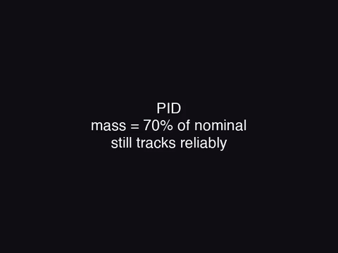

# Hybrid Reinforcement Learning and Residual PID for Quadrotor Trajectory Tracking

[](https://github.com/oyejam/quadrotor-hybrid-rl-pid/actions/workflows/docker-build.yml)

## Participants
- Jamiu Olaide Oyetunde — ISU/ITMO ID: 520194

## Description of the Conducted Research

See [docs/literature_review.md](docs/literature_review.md) for the analytical review of
prior work, [docs/research_plan.md](docs/research_plan.md) for the problem statement,
hypothesis, and methodology, and [docs/results.md](docs/results.md) for experimental
results.

**Short summary:**
This project compares three quadrotor trajectory-tracking controllers — a classical PID
controller, a pure reinforcement-learning policy (PPO), and a hybrid controller where an
RL agent learns a residual correction on top of PID — all trained with Domain
Randomization (DR) over the drone's mass. The hypothesis was that the hybrid controller
would degrade more gracefully than PID or PPO on mass values outside the training range.
**The result is the opposite**: PID completes the reference trajectory at every mass
tested (70%-130% of nominal), while both PPO and the hybrid controller fail to complete
it at all on almost every episode at or below nominal mass, only becoming reliable once
the true mass exceeds nominal by ≥10%. See [docs/results.md](docs/results.md) for the
full analysis, including a follow-up ablation and the methodological correction that
revealed this (an initial RMSE-only evaluation was misleading because a controller that
crashes immediately can show an artificially low error).

## Demonstration (Video)



**Direct link to the full video, with sound-free native playback and controls (mandatory
per course requirements):**
https://raw.githubusercontent.com/oyejam/quadrotor-hybrid-rl-pid/main/results/demo.mp4
(GitHub's README renderer strips `<video>` tags for security reasons, so the GIF above
is the inline preview; click the link for the real video file.)

27-second clip recorded headless on this project's own CPU-only machine
(`scripts/record_demo.py`), showing: PID tracking reliably at 70% of nominal mass, PPO
crashing almost immediately at exactly the mass its RMSE looked best at, PPO succeeding
once the drone is 20% heavier, the original hybrid controller crashing at nominal mass
despite the PID floor, and the tightened-clip hybrid (the one case the ablation in
docs/results.md §3.1 fixed) succeeding at nominal mass.

## Installation and Deployment

- Developed and trained on: local machine (CPU only, no GPU) for PID baseline and
  lightweight PPO runs; [Google Colab / other] for longer training runs if needed.
- Python version: 3.12 (required by the current `gym-pybullet-drones` release, which
  depends on `gymnasium` and `torch`, not the older `gym`-based API)

### System dependencies
None beyond Python 3.12 and a C/C++ build toolchain (needed by pybullet's wheel build
on some platforms; on macOS this is provided by Xcode Command Line Tools).

### Environment setup
`gym-pybullet-drones` is not published on PyPI, so it is vendored as a git clone under
`external/` and installed in editable mode.

**Note for Intel macOS (and any platform without a current PyTorch wheel):** the
upstream `gym-pybullet-drones` package pins `torch>=2.13`, but PyTorch stopped
publishing Intel-macOS wheels after `2.2.2`. The simulation code itself does not
import `torch` (only the `stable-baselines3` training backend does), so the package
is installed with `--no-deps` and the real dependencies are installed separately,
pinned to versions that are mutually compatible *and* available for this platform
(`torch==2.2.2` requires `stable-baselines3<=2.4.x`, since 2.5+ requires `torch>=2.3`).
If you're on a platform with current PyTorch wheels (Linux/Windows, or Apple Silicon),
you can likely skip the `--no-deps` step and just `pip install -e external/gym-pybullet-drones`.

```bash
python3 -m venv .venv
source .venv/bin/activate
pip install --upgrade pip

git clone --depth 1 https://github.com/utiasDSL/gym-pybullet-drones.git external/gym-pybullet-drones
pip install -e external/gym-pybullet-drones --no-deps   # core env only, skips its strict pins
pip install -r requirements.txt                          # the real, platform-compatible pins
```

### Docker (recommended if you're not on Intel macOS)

The venv setup above includes several Intel-macOS-specific workarounds (Python 3.12
via Homebrew, the `torch==2.2.2`/`stable-baselines3==2.4.1` pinning, the `--no-deps`
install trick) that only exist because PyPI has no current PyTorch wheel for that
platform. None of that is needed on a standard Linux container, so Docker gives a
plain "clone and run" path instead of following platform-specific instructions.

```bash
docker build -t quadrotor-hybrid-rl-pid .
docker run --rm quadrotor-hybrid-rl-pid                                  # PID baseline smoke test
docker run --rm quadrotor-hybrid-rl-pid python scripts/evaluate_robustness.py
docker run --rm -v "$(pwd)/results:/app/results" quadrotor-hybrid-rl-pid python scripts/train_ppo.py
```

Mount `results/` (as in the last example) if you want artifacts written inside the
container (trained models, CSVs, plots) to persist on the host afterward.

Note: `pybullet==3.2.7` has no published wheel for Python 3.12 on any platform yet, so
`docker build` compiles it from source the first time — expect that step alone to take
a few minutes. Every other pinned dependency installs from a prebuilt wheel.

**This project's own dev machine cannot run Docker at all**, so the Dockerfile is
verified a different way. Docker Desktop requires macOS 13 (Ventura) or newer; this is
a 2015 MacBook Air (model `MacBookAir7,2`) that Apple capped at macOS 12 (Monterey) —
Ventura was never released for this hardware. The lighter alternatives (Colima,
Podman) hit the same macOS-13+ floor, so this isn't fixable by picking different
tooling, and installing an unofficial OS patcher to work around Apple's own hardware
support cutoff was judged not worth the risk on a 10-year-old machine.

Instead, [`.github/workflows/docker-build.yml`](.github/workflows/docker-build.yml)
builds the image and runs its default smoke test on GitHub's own Linux runners on
every push (that's what the badge at the top of this README reflects) — real
verification on real infrastructure, independent of what this machine can run. Its
last confirmed run reproduced `RMSE=0.0896m` for the PID baseline at nominal mass,
matching this machine's own local result (`0.0904m`) to within normal floating-point
variation across different CPUs.

**The image intentionally pins the exact same package versions as the venv setup**
(not newer ones), so a result reproduced via Docker is reproducing the same
experiment that produced `docs/results.md`, not a different one.

## Running and Usage

- Train the PID baseline (no learning, scripted controller): `python scripts/run_pid_baseline.py`
- Train the PPO policy: `python scripts/train_ppo.py --config config/ppo.yaml`
- Train the hybrid residual policy: `python scripts/train_hybrid.py --config config/hybrid.yaml`
- Evaluate robustness under domain shift: `python scripts/evaluate_robustness.py`
- Reproduce all plots: `python scripts/make_plots.py`
- Record the demo video: `python scripts/record_demo.py`

## Description of the Obtained Results

PID reliably completes the reference trajectory at every tested mass (70%-130% of
nominal): 100% success rate, RMSE 0.09-0.11m throughout. Both PPO and the hybrid
controller (PID + RL residual) fail to complete the trajectory on almost every episode
at or below nominal mass, and only become reliable once the drone is at least 10%
heavier than what they were trained around. A follow-up ablation (tightening the
hybrid's residual bound) fixed this specifically at nominal mass but not the broader
pattern. Full tables, plots, and discussion: [docs/results.md](docs/results.md).
Raw data: [results/robustness_sweep.csv](results/robustness_sweep.csv). Plots:
[results/robustness_plot.png](results/robustness_plot.png) and
[results/success_rate_plot.png](results/success_rate_plot.png).

## License
MIT — see [LICENSE](LICENSE).
